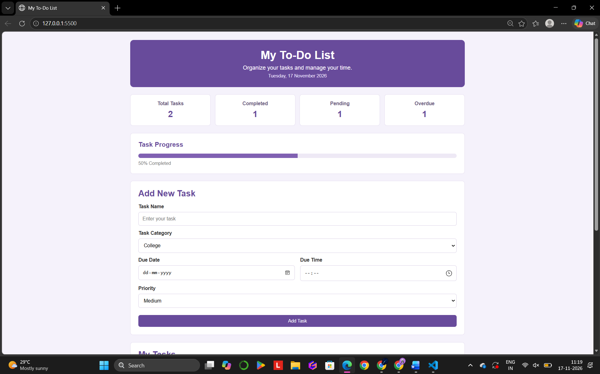
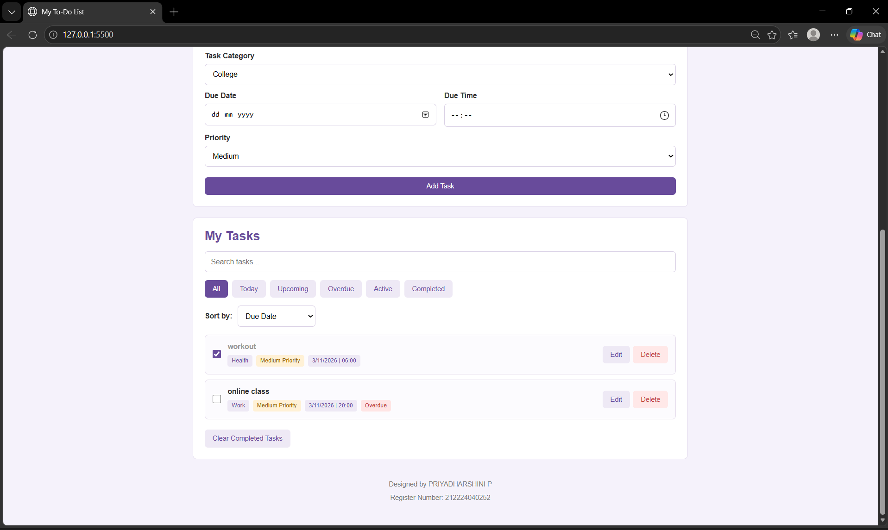

# Ex03 To-Do List using JavaScript
## Date:02-11-2026

## AIM
To create a To-do Application with all features using JavaScript.

## ALGORITHM

### STEP 1

Create the HTML structure of the Smart To-Do Application using `index.html`.

### STEP 2

Design and style the application using `style.css` with an attractive and responsive layout.

### STEP 3

Plan the required features, including task categories, due dates, due times and priority levels.

### STEP 4

Create the To-Do Application using JavaScript in `script.js`.

### STEP 5

Implement functionalities to add, edit, delete and complete tasks.

### STEP 6

Add task filters such as All, Today, Upcoming, Overdue, Active and Completed.

### STEP 7

Implement search, sorting, progress tracking and browser reminders.

### STEP 8

Use Local Storage to save tasks and maintain them even after refreshing the page.

### STEP 9

Test all functionalities and fix errors. Refine the styling and layout for a better user experience.

### STEP 10

Open the HTML file in a browser using Live Server to check the application's appearance and functionality.

### STEP 11

Capture screenshots of the completed application for the output section.

### STEP 12

Upload the project files to GitHub and push the latest changes.

### STEP 13

Deploy the application using GitHub Pages for free hosting.

## PROGRAM
### index.html
```

<!DOCTYPE html>
<html lang="en">
<head>
    <meta charset="UTF-8">
    <meta name="viewport" content="width=device-width, initial-scale=1.0">
    <title>My To-Do List</title>
    <link rel="stylesheet" href="style.css">
</head>
<body>

    <div class="container">

        <header>
            <h1>My To-Do List</h1>
            <p>Organize your tasks and manage your time.</p>
            <p id="todayDate"></p>
        </header>

        <section class="summary">
            <div class="summary-box">
                <h3>Total Tasks</h3>
                <p id="totalCount">0</p>
            </div>

            <div class="summary-box">
                <h3>Completed</h3>
                <p id="completedCount">0</p>
            </div>

            <div class="summary-box">
                <h3>Pending</h3>
                <p id="pendingCount">0</p>
            </div>

            <div class="summary-box">
                <h3>Overdue</h3>
                <p id="overdueCount">0</p>
            </div>
        </section>

        <section class="progress-section">
            <h3>Task Progress</h3>
            <div class="progress-track">
                <div id="progressBar"></div>
            </div>
            <p id="progressPercent">0% Completed</p>
        </section>

        <section class="task-form">
            <h2>Add New Task</h2>

            <form id="taskForm">

                <label for="taskInput">Task Name</label>
                <input type="text" id="taskInput"
                    placeholder="Enter your task" required>

                <label for="category">Task Category</label>
                <select id="category">
                    <option value="College">College</option>
                    <option value="Personal">Personal</option>
                    <option value="Work">Work</option>
                    <option value="Shopping">Shopping</option>
                    <option value="Health">Health</option>
                    <option value="Other">Other</option>
                </select>

                <div class="form-row">
                    <div>
                        <label for="dueDate">Due Date</label>
                        <input type="date" id="dueDate" required>
                    </div>

                    <div>
                        <label for="dueTime">Due Time</label>
                        <input type="time" id="dueTime" required>
                    </div>
                </div>

                <label for="priority">Priority</label>
                <select id="priority">
                    <option value="High">High</option>
                    <option value="Medium" selected>Medium</option>
                    <option value="Low">Low</option>
                </select>

                <button type="submit" id="submitBtn">Add Task</button>
                <button type="button" id="cancelEdit" hidden>
                    Cancel
                </button>

            </form>
        </section>

        <section class="task-section">
            <h2>My Tasks</h2>

            <input type="search" id="searchInput"
                placeholder="Search tasks...">

            <div class="filters">
                <button class="filter active" data-filter="All">All</button>
                <button class="filter" data-filter="Today">Today</button>
                <button class="filter" data-filter="Upcoming">Upcoming</button>
                <button class="filter" data-filter="Overdue">Overdue</button>
                <button class="filter" data-filter="Active">Active</button>
                <button class="filter" data-filter="Completed">Completed</button>
            </div>

            <div class="sort-section">
                <label for="sortTasks">Sort by:</label>
                <select id="sortTasks">
                    <option value="date">Due Date</option>
                    <option value="priority">Priority</option>
                    <option value="name">Task Name</option>
                </select>
            </div>

            <ul id="taskList"></ul>

            <p id="emptyMessage">
                No tasks available. Add a new task to get started!
            </p>

            <button type="button" id="clearCompleted">
                Clear Completed Tasks
            </button>
        </section>

        <footer>
            <p>Designed by PRIYADHARSHINI P</p>
            <p>Register Number: 212224040252</p>
        </footer>

    </div>

    <script src="script.js"></script>
</body>
</html>

```
### style.css
```

* {
    margin: 0;
    padding: 0;
    box-sizing: border-box;
}

body {
    font-family: Arial, sans-serif;
    background-color: #f5f2fb;
    color: #333;
    padding: 25px 15px;
}

.container {
    max-width: 950px;
    margin: auto;
}

header {
    text-align: center;
    background-color: #684b9b;
    color: white;
    padding: 25px;
    border-radius: 10px;
    margin-bottom: 20px;
}

header h1 {
    margin-bottom: 8px;
}

header p {
    margin-top: 6px;
}

#todayDate {
    font-size: 13px;
    color: #eee5ff;
}

.summary {
    display: grid;
    grid-template-columns: repeat(4, 1fr);
    gap: 12px;
    margin-bottom: 20px;
}

.summary-box {
    background-color: white;
    padding: 18px;
    text-align: center;
    border: 1px solid #e4dcef;
    border-radius: 8px;
}

.summary-box h3 {
    font-size: 14px;
    color: #6b5b80;
}

.summary-box p {
    font-size: 25px;
    font-weight: bold;
    color: #684b9b;
    margin-top: 8px;
}

.progress-section,
.task-form,
.task-section {
    background-color: white;
    padding: 22px;
    border: 1px solid #e4dcef;
    border-radius: 8px;
    margin-bottom: 20px;
}

.progress-section h3,
.task-form h2,
.task-section h2 {
    color: #684b9b;
    margin-bottom: 15px;
}

.progress-track {
    height: 12px;
    background-color: #eee9f5;
    border-radius: 10px;
    overflow: hidden;
}

#progressBar {
    width: 0;
    height: 100%;
    background-color: #8061b2;
    transition: width 0.3s;
}

#progressPercent {
    font-size: 13px;
    margin-top: 8px;
    color: #777;
}

label {
    display: block;
    font-size: 14px;
    font-weight: bold;
    margin: 13px 0 7px;
}

input,
select {
    width: 100%;
    padding: 11px;
    border: 1px solid #d9d0e5;
    border-radius: 6px;
    background-color: #fff;
    font-size: 14px;
}

input:focus,
select:focus {
    outline: 1px solid #8061b2;
    border-color: #8061b2;
}

.form-row {
    display: grid;
    grid-template-columns: 1fr 1fr;
    gap: 15px;
}

button {
    cursor: pointer;
    border: none;
    border-radius: 6px;
    padding: 10px 15px;
    font-size: 13px;
}

#submitBtn {
    background-color: #684b9b;
    color: white;
    width: 100%;
    margin-top: 20px;
}

#submitBtn:hover {
    background-color: #503778;
}

#cancelEdit {
    background-color: #eee9f5;
    color: #684b9b;
    width: 100%;
    margin-top: 8px;
}

#searchInput {
    margin-bottom: 15px;
}

.filters {
    display: flex;
    flex-wrap: wrap;
    gap: 8px;
    margin-bottom: 15px;
}

.filter {
    background-color: #eee9f5;
    color: #684b9b;
}

.filter.active {
    background-color: #684b9b;
    color: white;
}

.sort-section {
    display: flex;
    align-items: center;
    gap: 10px;
    margin-bottom: 15px;
}

.sort-section label {
    margin: 0;
}

.sort-section select {
    width: auto;
    min-width: 150px;
}

#taskList {
    list-style: none;
}

.task {
    display: flex;
    align-items: center;
    gap: 12px;
    padding: 14px;
    border: 1px solid #e5ddec;
    border-radius: 7px;
    margin-bottom: 10px;
    background-color: #fcfbfe;
}

.task-check {
    width: 17px;
    height: 17px;
    accent-color: #684b9b;
}

.task-content {
    flex: 1;
    min-width: 0;
}

.task-name {
    font-size: 14px;
    font-weight: bold;
    overflow-wrap: anywhere;
}

.task-details {
    display: flex;
    flex-wrap: wrap;
    gap: 7px;
    margin-top: 8px;
}

.chip {
    font-size: 11px;
    padding: 5px 8px;
    border-radius: 4px;
    background-color: #eee9f5;
    color: #684b9b;
}

.priority-High {
    background-color: #ffe5e5;
    color: #c03939;
}

.priority-Medium {
    background-color: #fff1d6;
    color: #95630c;
}

.priority-Low {
    background-color: #e1f3e5;
    color: #347647;
}

.overdue-chip {
    background-color: #ffe5e5;
    color: #c03939;
}

.completed .task-name {
    text-decoration: line-through;
    color: #999;
}

.task-actions {
    display: flex;
    gap: 6px;
}

.task-actions button {
    background-color: #eee9f5;
    color: #684b9b;
}

.task-actions .delete-btn {
    background-color: #ffe8e8;
    color: #c03939;
}

#emptyMessage {
    text-align: center;
    color: #888;
    padding: 20px;
    font-size: 14px;
}

#clearCompleted {
    background-color: #eee9f5;
    color: #684b9b;
    margin-top: 10px;
}

footer {
    text-align: center;
    color: #777;
    font-size: 13px;
    line-height: 2;
    padding: 15px;
}

@media (max-width: 600px) {
    .summary {
        grid-template-columns: repeat(2, 1fr);
    }

    .form-row {
        grid-template-columns: 1fr;
        gap: 0;
    }

    .task {
        flex-wrap: wrap;
    }

    .task-actions {
        width: 100%;
        justify-content: flex-end;
    }

    header h1 {
        font-size: 23px;
    }
}

```
### script.js
```

// Get HTML elements
const taskForm = document.getElementById("taskForm");
const taskInput = document.getElementById("taskInput");
const category = document.getElementById("category");
const dueDate = document.getElementById("dueDate");
const dueTime = document.getElementById("dueTime");
const priority = document.getElementById("priority");

const taskList = document.getElementById("taskList");
const searchInput = document.getElementById("searchInput");
const sortTasks = document.getElementById("sortTasks");

const totalCount = document.getElementById("totalCount");
const completedCount = document.getElementById("completedCount");
const pendingCount = document.getElementById("pendingCount");
const overdueCount = document.getElementById("overdueCount");

const progressBar = document.getElementById("progressBar");
const progressPercent = document.getElementById("progressPercent");

const submitBtn = document.getElementById("submitBtn");
const cancelEdit = document.getElementById("cancelEdit");

let tasks = JSON.parse(localStorage.getItem("tasks")) || [];
let currentFilter = "All";
let editingId = null;

// Display current date
document.getElementById("todayDate").textContent =
    new Date().toLocaleDateString("en-IN", {
        weekday: "long",
        day: "numeric",
        month: "long",
        year: "numeric"
    });

// Save tasks in Local Storage
function saveTasks() {
    localStorage.setItem("tasks", JSON.stringify(tasks));
}

// Check overdue tasks
function isOverdue(task) {
    const taskDate = new Date(task.date + "T" + task.time);
    return !task.completed && taskDate < new Date();
}

// Add or update task
taskForm.addEventListener("submit", function(event) {
    event.preventDefault();

    const taskName = taskInput.value.trim();

    if (taskName === "") {
        alert("Please enter a task name.");
        return;
    }

    if (editingId !== null) {
        const task = tasks.find(item => item.id === editingId);

        task.text = taskName;
        task.category = category.value;
        task.date = dueDate.value;
        task.time = dueTime.value;
        task.priority = priority.value;
        task.notified = false;

    } else {
        tasks.push({
            id: Date.now(),
            text: taskName,
            category: category.value,
            date: dueDate.value,
            time: dueTime.value,
            priority: priority.value,
            completed: false,
            notified: false
        });

        // Request notification permission
        if ("Notification" in window &&
            Notification.permission === "default") {
            Notification.requestPermission();
        }
    }

    saveTasks();
    resetForm();
    displayTasks();
});

// Reset form
function resetForm() {
    taskForm.reset();
    priority.value = "Medium";

    editingId = null;
    submitBtn.textContent = "Add Task";
    cancelEdit.hidden = true;
}

// Cancel editing
cancelEdit.addEventListener("click", resetForm);

// Edit task
function editTask(id) {
    const task = tasks.find(item => item.id === id);

    taskInput.value = task.text;
    category.value = task.category;
    dueDate.value = task.date;
    dueTime.value = task.time;
    priority.value = task.priority;

    editingId = id;
    submitBtn.textContent = "Update Task";
    cancelEdit.hidden = false;

    taskInput.focus();
}

// Delete task
function deleteTask(id) {
    if (confirm("Do you want to delete this task?")) {
        tasks = tasks.filter(task => task.id !== id);

        if (editingId === id) {
            resetForm();
        }

        saveTasks();
        displayTasks();
    }
}

// Mark task as completed
function completeTask(id) {
    const task = tasks.find(item => item.id === id);

    task.completed = !task.completed;

    saveTasks();
    displayTasks();
}

// Display tasks
function displayTasks() {
    taskList.innerHTML = "";

    const today = new Date();
    const todayString = [
        today.getFullYear(),
        String(today.getMonth() + 1).padStart(2, "0"),
        String(today.getDate()).padStart(2, "0")
    ].join("-");

    const searchText = searchInput.value.toLowerCase();

    let filteredTasks = tasks.filter(task => {
        const matchesSearch =
            task.text.toLowerCase().includes(searchText) ||
            task.category.toLowerCase().includes(searchText);

        let matchesFilter = true;

        if (currentFilter === "Today") {
            matchesFilter = task.date === todayString;
        }

        if (currentFilter === "Upcoming") {
            matchesFilter = task.date > todayString &&
                !task.completed;
        }

        if (currentFilter === "Overdue") {
            matchesFilter = isOverdue(task);
        }

        if (currentFilter === "Active") {
            matchesFilter = !task.completed;
        }

        if (currentFilter === "Completed") {
            matchesFilter = task.completed;
        }

        return matchesSearch && matchesFilter;
    });

    // Sort tasks
    if (sortTasks.value === "date") {
        filteredTasks.sort((a, b) =>
            new Date(a.date + "T" + a.time) -
            new Date(b.date + "T" + b.time)
        );
    }

    if (sortTasks.value === "priority") {
        const order = { High: 1, Medium: 2, Low: 3 };

        filteredTasks.sort((a, b) =>
            order[a.priority] - order[b.priority]
        );
    }

    if (sortTasks.value === "name") {
        filteredTasks.sort((a, b) =>
            a.text.localeCompare(b.text)
        );
    }

    // Create task cards
    filteredTasks.forEach(task => {
        const li = document.createElement("li");
        li.className = "task";

        if (task.completed) {
            li.classList.add("completed");
        }

        // Checkbox
        const checkbox = document.createElement("input");
        checkbox.type = "checkbox";
        checkbox.className = "task-check";
        checkbox.checked = task.completed;

        checkbox.addEventListener("change", function() {
            completeTask(task.id);
        });

        // Task details
        const content = document.createElement("div");
        content.className = "task-content";

        const name = document.createElement("div");
        name.className = "task-name";
        name.textContent = task.text;

        const details = document.createElement("div");
        details.className = "task-details";

        const categoryChip = document.createElement("span");
        categoryChip.className = "chip";
        categoryChip.textContent = task.category;

        const priorityChip = document.createElement("span");
        priorityChip.className =
            "chip priority-" + task.priority;
        priorityChip.textContent =
            task.priority + " Priority";

        const dateChip = document.createElement("span");
        dateChip.className = "chip";
        dateChip.textContent =
            new Date(task.date + "T00:00:00")
                .toLocaleDateString("en-IN") +
            " | " + task.time;

        details.append(categoryChip, priorityChip, dateChip);

        if (isOverdue(task)) {
            const overdueChip = document.createElement("span");
            overdueChip.className = "chip overdue-chip";
            overdueChip.textContent = "Overdue";
            details.appendChild(overdueChip);
        }

        content.append(name, details);

        // Edit and delete buttons
        const actions = document.createElement("div");
        actions.className = "task-actions";

        const editButton = document.createElement("button");
        editButton.textContent = "Edit";
        editButton.addEventListener("click", function() {
            editTask(task.id);
        });

        const deleteButton = document.createElement("button");
        deleteButton.textContent = "Delete";
        deleteButton.className = "delete-btn";
        deleteButton.addEventListener("click", function() {
            deleteTask(task.id);
        });

        actions.append(editButton, deleteButton);
        li.append(checkbox, content, actions);

        taskList.appendChild(li);
    });

    // Show message when no tasks are available
    document.getElementById("emptyMessage").hidden =
        filteredTasks.length > 0;

    updateSummary();
}

// Update task counts and progress
function updateSummary() {
    const completed = tasks.filter(task => task.completed).length;
    const pending = tasks.length - completed;
    const overdue = tasks.filter(isOverdue).length;

    totalCount.textContent = tasks.length;
    completedCount.textContent = completed;
    pendingCount.textContent = pending;
    overdueCount.textContent = overdue;

    let progress = 0;

    if (tasks.length > 0) {
        progress = Math.round(
            (completed / tasks.length) * 100
        );
    }

    progressBar.style.width = progress + "%";
    progressPercent.textContent = progress + "% Completed";
}

// Filter tasks
document.querySelectorAll(".filter").forEach(button => {
    button.addEventListener("click", function() {
        currentFilter = button.dataset.filter;

        document.querySelectorAll(".filter").forEach(item => {
            item.classList.remove("active");
        });

        button.classList.add("active");
        displayTasks();
    });
});

// Search tasks
searchInput.addEventListener("input", displayTasks);

// Sort tasks
sortTasks.addEventListener("change", displayTasks);

// Clear completed tasks
document.getElementById("clearCompleted").addEventListener(
    "click", function() {

        const completed = tasks.filter(task => task.completed);

        if (completed.length === 0) {
            alert("No completed tasks to clear.");
            return;
        }

        if (confirm("Clear all completed tasks?")) {
            tasks = tasks.filter(task => !task.completed);

            saveTasks();
            displayTasks();
        }
    }
);

// Check for due task reminders
function checkReminders() {
    if (!("Notification" in window) ||
        Notification.permission !== "granted") {
        return;
    }

    tasks.forEach(task => {
        const taskDate = new Date(task.date + "T" + task.time);

        if (!task.completed && !task.notified &&
            taskDate <= new Date()) {

            new Notification("Task Reminder", {
                body: "Your task is due: " + task.text
            });

            task.notified = true;
            saveTasks();
        }
    });
}

// Check reminders every 30 seconds
setInterval(checkReminders, 30000);

// Display saved tasks when page opens
displayTasks();
checkReminders();

```

## OUTPUT

### 1. Main Page


### 2. Task Management



## RESULT
The program for creating To-do list using JavaScript is executed successfully.
